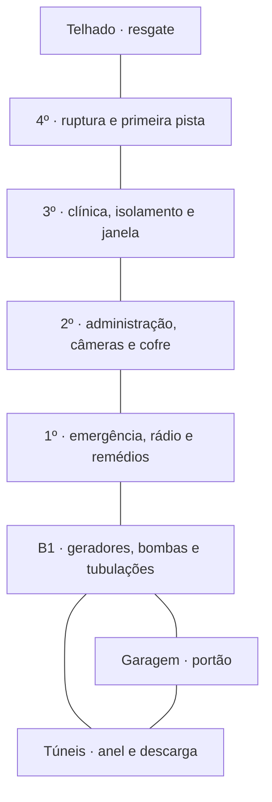

# Hospital — mapa lógico jogável (proposta de blockout)

**Estado:** direção e grafo inicial, ainda sem escala física. Fonte de visão: [GDD Mestre](../GDD/GDD_MASTER.md), seções 22–31 e 53–56. Dados: [`hospital_graph.json`](../../Tools/MapCore/hospital_graph.json). Validação: [`validate_map.py`](../../Tools/MapCore/validate_map.py). Direção baseada nos vídeos enviados: [Bíblia visual](../Visual/BIBLIA_VISUAL_HOSPITAL.md).

O hospital deve parecer grande pela memória espacial: enxergar um lugar cedo, alcançá-lo por outra porta mais tarde, ouvir eventos em andares próximos e descobrir que o mesmo tubo passa sob várias salas. Para aproximadamente três horas no Difícil, a densidade e o retorno com nova informação importam mais que corredores extensos. **88 nós são áreas lógicas, não 88 salas a modelar nem garantia de três horas de gameplay.** Tamanho, portas, velocidades e duração dependem do blockout e dos testes na Unreal.

## Organização

Há **escada leste e oeste independentes** do telhado ao quarto andar e do quarto à garagem. Os andares têm anéis de corredores e salas de passagem; a ala técnica cria uma terceira leitura vertical do espaço. O elevador liga 4º, 3º, 2º, 1º e B1 quando houver energia, como atalho de risco e ruído, sem ser obrigatório para qualquer fuga. Os túneis têm dois ramais sem saída e um anel reconhecível por marcas e pelo som da casa de bombas. A janela do 3º leva a um anexo vizinho; a travessia é de mão única.

| Setor | Âncoras e identidade | Retorno com novo propósito |
| --- | --- | --- |
| 4º, início | Quarto da ruptura `F4_START`, posto `F4_NURSE`, observação da cidade `F4_OBSERVATION`, enfermarias e lençóis | Ler primeira parte da combinação; perceber alterações e obter passagem técnica |
| 3º, clínica | Centro cirúrgico `F3_SURGERY`, UTI, recuperação, exames, janela `F3_WINDOW`, utilidades `F3_UTILITY` | Examinar a janela; voltar com ferramentas; descobrir isolamento por pista local |
| 2º, administração | Arquivo `F2_ARCHIVE`, segurança `F2_SECURITY`, câmeras `F2_CAMERAS`, servidores `F2_SERVER`, cofre `F2_SAFE`, almoxarifado `F2_SUPPLY` | Cruzar código, cofre, pilhas, interferência e ferramentas sem obrigar uma ordem única |
| 1º, emergência | Átrio exposto, farmácia `F1_PHARMACY`, rádio `F1_RADIO`, guarita `F1_SECURITY`, doca | Tratamento arriscado; descobrir existência da chave; preparar chamada e iniciar corrida ao telhado |
| B1, serviço | Geradores `B1_GENERATOR`, lavanderia, necrotério, bombas, válvulas e entrada `B1_TUNNEL` | Restaurar energia, ler última pista do cofre, aprender acesso subterrâneo |
| Garagem | Fileiras de veículos, oficina, controle `G_CONTROL`, portão `G_GATE` | Abrir saída com chave e energia; conexão técnica para túneis |
| Telhado / túneis / anexo | Máquinas de climatização e pouso; ramais pluviais; passarela estreita | Cada espaço tem silhueta, som e risco distintos para a decisão final |

## Caminhos que dão escala sem alongar a caminhada

- **Dois eixos de escada:** a rota vista do corredor leste tem pontos de exposição; a oeste cruza salas e acessos de serviço. Fechar temporariamente um lance nunca pode tornar as quatro fugas inviáveis. Sinalizar andares nas portas e usar vista parcial entre níveis para orientar.
- **Prumada de tubulação:** `F4_SERVICE ↔ F3_PIPE ↔ F2_SERVICE ↔ F1_SERVICE ↔ B1_PIPE` e `B1_VALVE ↔ G_TUNNEL_LINK`. Passagens estreitas reduzem velocidade, amplitude visual e capacidade de manobra. A IA não ganha visão através delas: pode inferir entrada observada, investigar uma boca ou chegar por outro caminho.
- **Anéis locais:** enfermarias e banhos no 4º; cirurgia, UTI e exames no 3º; arquivo, câmeras e almoxarifado no 2º; triagem, farmácia e rádio no 1º; lavanderia, válvulas e geradores em B1. Cada anel dá uma escolha de risco, cobertura ou recurso.
- **Visadas curtas e memorizáveis:** a sala de observação mostra o parapeito do telhado; um átrio parcial relaciona 3º e 2º; o monitor do 2º pode mostrar o saguão se a câmera funcionar; faróis e chuva recortam o portão na garagem. Essas visadas são pistas visuais condicionais, não informação automática ao Hunter.
- **Marcos de orientação:** tubo vermelho de incêndio, tubo de água marcado em azul, reservatório de B1, vidro quebrado da clínica e luz intermitente no 4º. A cor nunca é a única pista; forma, texto, som e localização reforçam o caminho.

## Portas, circuitos, câmeras e esconderijos

O JSON agora contém 22 portas em conexões identificadas, 3 circuitos, 5 câmeras e 10 esconderijos. São **pontos de interação lógica iniciais**, não contagem final de objetos no nível. `WorldCore` mantém seus estados no mesmo `WorldState` do checkpoint de campanha.

| Mudança | Efeito legível | Garantia de alternativa |
| --- | --- | --- |
| Desligar `C_SECURITY` | Algumas câmeras do 2º perdem imagem; `D_F2_SERVER` não abre por controle elétrico | Servidores também são acessíveis via almoxarifado; escadas e tubos seguem manuais |
| Restaurar `C_SERVICE` | A câmera da garagem ganha energia e o controle do portão pode ser preparado | Câmera em loop continua mostrando imagem antiga; energia não conserta interferência |
| Cortar energia numa porta `releases_when_off` | Fecho elétrico libera abertura manual, com ruído possível | Não abre automaticamente o portão de fuga nem concede sua chave |
| Forçar porta trancada | Abre a ligação se não estiver emperrada, produz ruído e muda o estado persistido | Hunter só investiga se o evento chegar ao seu sensor com oclusão/mascaramento real |
| Entrar no isolamento `H_F3_ISOLATION` | Ocupa o esconderijo no mundo | Batman não sabe disso por leitura do save; precisa ter visto a entrada/evidência |

O validador também percorre as quatro fugas com todas as portas `needs_power` e a porta inicialmente trancada indisponíveis. Portas manuais são atravessáveis após interação, com custo e som a medir na Unreal.

## Quatro fugas e distribuição da informação

| Rota | Descoberta e preparo | Ação final / estado de falha |
| --- | --- | --- |
| Garagem | Registro na guarita `F1_SECURITY` indica que existe uma chave. Segurança `F2_SECURITY` aponta o cofre. Fragmentos de uma combinação de seis dígitos em `F4_NURSE`, `F2_ARCHIVE` e `B1_GENERATOR`; abrir `F2_SAFE`; retirar a chave; restabelecer energia em B1. Os dígitos e texto final ainda precisam ser escritos. | Acionar `G_CONTROL`, passar pelo portão. `garage_failed` bloqueia só `X_GARAGE`. |
| Telhado | Rádio `F1_RADIO`, pilhas `F2_SERVER`, interferência tratada em `F2_CAMERAS`; montar equipamento, falar com o chefe. | **Após confirmação** do helicóptero, contar aproximadamente cinco minutos e alcançar `R_PAD`. `roof_failed` bloqueia só `X_ROOF`. Não disparar confirmação automaticamente ao encontrar o rádio. |
| Túneis | Encontrar `B1_TUNNEL` a partir da casa de bombas, reconhecer bifurcação, ramais mortos e anel de manutenção. A conexão pela garagem também exige a descoberta da entrada. | Alcançar a descarga `T_EXIT`. `tunnel_failed` bloqueia só `X_TUNNEL`. No Punitivo, Robin pode investigar o sistema. |
| Janela | Identificar `F3_WINDOW`, pegar ferramentas em `F2_SUPPLY`, voltar e remover a trava sem denunciar a posição. | Passar ao anexo `A_BRIDGE` e sair. `window_failed` bloqueia só `X_WINDOW`; barulho da remoção e exposição da travessia são resolvidos pelo gameplay. |

O grafo não define **como** uma rota falha, nem garante que o jogador conheça uma pista. Falhas precisam de evento observável e feedback justo; em geral uma falha não encerra a partida. O ponto do isolamento `F3_ISOLATION` só fica disponível depois de descobrir o acesso em `F3_UTILITY`; a segurança real do esconderijo depende dos sistemas de percepção, não do nome da sala. Portas trancadas por ato, mudança do espaço e posição dos companheiros ainda serão autoradas.

## Ritmo de três horas: intenção, não cronômetro de conteúdo

| Faixa provisória no Difícil | Experiência pretendida | Reuso do mapa |
| --- | --- | --- |
| 0–25 min | Ruptura no 4º, Thomas desaparece, primeiros sinais do predador | Conhecer dois corredores, escadas e uma vista do telhado |
| 25–70 min | Explorar clínica e administração, escolher primeiras hipóteses de fuga | Abrir anéis, lembrar pistas e reconhecer câmeras |
| 70–125 min | Descer à emergência e B1, adquirir ferramentas e informação | Revisitar 2º/3º por outras entradas; risco de tratamento e ruído |
| 125–165 min | Preparar uma ou mais fugas, decisões e consequências dos companheiros | Atalhos, energia, tubulações e escalada de pressão |
| 165–180 min | Tentativa final, fuga alternativa ou sobrevivência até amanhecer | Corrida ao telhado é apenas um possível clímax, não um ato obrigatório |

Essas faixas **não** são metas individuais de missão, tempos de travessia medidos ou garantia de duração. Testar jogadores que conhecem e que não conhecem o espaço; se três horas vierem só de procurar uma porta ou refazer corredores, reduzir atrito e redistribuir pistas.

## Direção visual e sonora para o blockout

- **The Last of Us:** desgaste com história legível — reparos improvisados, abandono desigual, vegetação e vestígios de quem tentou sobreviver. A circulação deve continuar clara sob sujeira e dano.
- **Outlast:** pressão clínica — luz incompleta, materiais frios, som atravessando portas, máquinas e silêncios. Áreas estreitas alternam com vazios expostos; esconderijos dão oportunidade, não invulnerabilidade.
- **Cinco vídeos enviados em 30/09:** corredores clínicos com luz vermelha localizada, instalações técnicas úmidas, feixes de lanterna e silhuetas emergindo da escuridão foram observados diretamente nos arquivos. Ver a bíblia visual para correspondência por setor e limites de legibilidade. O short anterior agora está disponível também como arquivo `78713.mp4`.
- **Tubulações como assinatura:** vapor denuncia um cruzamento; golpes metálicos podem mascarar um passo; válvulas e juntas repetidas dão direção entre andares. Diferenciar ruído ambiente de evidência real para a IA.

Evitar reproduzir composição, símbolos ou cenário específico de uma referência. A identidade final de personagens, marca e assets tem decisão de publicação própria em D-10.

## Contrato para implementar na Unreal

Cada `node.id` identifica um volume/área lógica, **não** uma sala 1:1. Cada `edge` é conexão navegável com `seconds` provisórios, `requires`, `forbids`, direção e exposição. Cada `action` tem um ponto, pré-requisitos, flag concedida e, quando cabível, `run_event` do `RunRules`. `sightlines` são possibilidades a verificar com geometria e estado de câmera; `hunter_access: false` numa passagem estreita proíbe aquela aresta física ao Hunter, sem teleportar ou lhe dar informação. Conectar atores, portas, checkpoints e áudio por ID estável. Conversões de unidades, persistência das flags e eventos dependem dos adaptadores Unreal.

Antes de consolidar a planta: blockout em escala; trajetos cronometrados com interação e perseguição; visibilidade/cobertura; perseguição em cada atalho; orientação sem HUD; quatro rotas e falhas combinadas; save/load em travas e travessia de mão única; desempenho em vista do átrio e do telhado. O validador prova só consistência e alcançabilidade abstrata.
